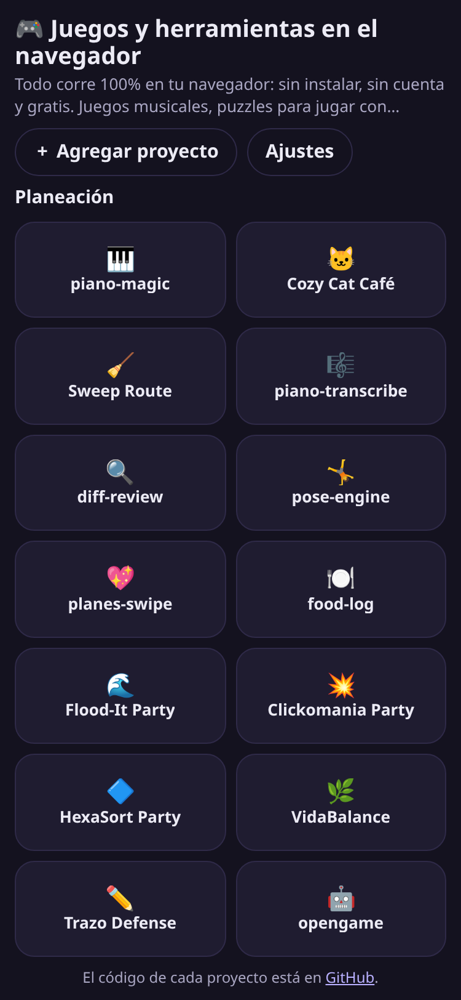

# juliangdeveloper.github.io

Juegos y herramientas que se abren en el navegador, sin instalar.

**[Abrir el portafolio](https://juliangdeveloper.github.io/)**

## Cómo se usa

- Toca una tarjeta con fase para ver el detalle. El botón abre la app a pantalla completa, con **Inicio** para volver. Si a la app le falta información, al tocarla (en la grilla o en la mazmorra) sale un aviso: **Copiar prompt** copia las instrucciones para que la app guarde su meta, y **Ya lo hice** la abre. Se puede cerrar sin abrirla.
- **＋ Agregar proyecto** acepta `usuario.github.io/repo`, `github.com/usuario/repo` o `usuario/repo`.
- **✕** deja de seguir un proyecto y se puede deshacer. **Restaurar proyectos por defecto** devuelve los de fábrica y conserva los que agregaste. El proyecto fijo se queda y no tiene ✕.
- La lista queda en este navegador. En el celular y en la tablet la pantalla no se desplaza.
- La fase sale de `meta.v1.<app>` si `proyecto.fase` es un entero de 1 a 7 (también vale un texto numérico): Planeación, Definición, Diseño, Construcción, Validación, Lanzamiento o Descartada. Si faltan el estado o las fases completadas, o no se pueden leer, la fase igual se usa y esos datos quedan en cero. Un slug distinto al de la tarjeta se ignora. Sin fase legible, la app queda en **Planeación**.
- En **Ajustes**, **Mazmorra** empieza apagada. Cada proyecto es un objeto en la sala de su fase. Definición y Diseño comparten sala. Una sala sin proyectos no se muestra.
- Toca el nivel (Ceniza, Brasa, Llama, Forja o Faro) para ver cuántos lanzamientos pide, cuántos proyectos caben y cuánto falta para el siguiente.
- Si una sala supera su cupo, lo que sobra es una pila con el número. Al tocarla ves las apps de esa sala.
- **Trono** agrupa las habilidades de `proyecto.aportes`. Cada entrada es `{stat, exp, fuente}`: `stat` es el nombre tal como lo escribe la app, `exp` un entero de 1 a 99 y `fuente` `creacion` o `uso`. También vale `{id, aporte, fuente}`: `id` se muestra como nombre y `aporte` cuenta como exp. Una entrada inválida se ignora. Los stats con el mismo nombre exacto se suman. El panel muestra cada stat con su EXP total; al tocarlo, la EXP que aporta cada app y si es por creación o por uso. Si no caben todas las filas, se pasa de página. Si `proyecto.bloqueada` es `true`, el objeto se ve bloqueado.

## Stack

HTML, CSS y JavaScript, sin build. Los datos quedan en `localStorage`.

## Licencia

MIT
