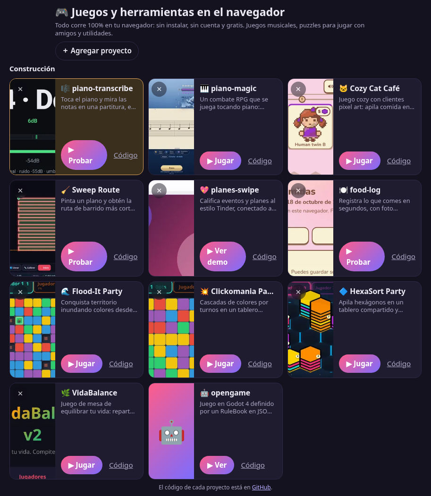

# 🎮 juliangdeveloper.github.io

**Browser portfolio of free games and tools: piano RPG, party puzzles, and utilities with no install.**

> Juegos y herramientas que se abren en el navegador: eliges uno y juegas, sin instalar nada.

**[▶ Abrir el portafolio](https://juliangdeveloper.github.io/)**

## Cómo se usa
- Toca una tarjeta para ver el detalle; **Jugar** o **Probar** abre la app a pantalla completa, con un botón de inicio al pie.
- **＋ Agregar proyecto** acepta `usuario.github.io/repo`, `github.com/usuario/repo` o `usuario/repo`, y arma la tarjeta con el título, la descripción y la imagen.
- **✕** deja de seguir un proyecto, con opción de deshacer. **Restaurar proyectos por defecto** devuelve los de fábrica y conserva los que agregaste.
- La lista se guarda en el navegador. En el celular los proyectos caben sin scroll; si ya abriste una app, su tarjeta muestra la fase y el estado.
- En **Ajustes**, **Mazmorra** —apagada al empezar— pone cada proyecto como un objeto en la sala de su fase. Definición y Diseño comparten sala. Si una sala no tiene proyectos, no se muestra.
- Cuando una sala supera su cupo, el resto queda en una pila; al tocarla aparece la lista de apps de esa sala, cada una con su enlace.

## Stack
HTML, CSS y JavaScript vanilla, sin frameworks ni build. Datos en `localStorage`.

## Licencia
MIT
