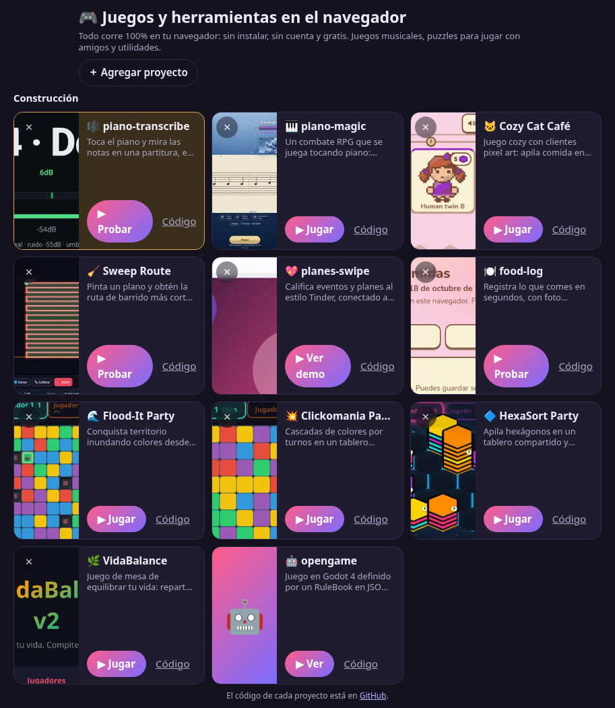

# 🎮 juliangdeveloper.github.io

> Portafolio de juegos y herramientas que corren 100% en el navegador: sin instalar, sin cuenta y gratis.

**[▶ Abrir el portafolio](https://juliangdeveloper.github.io/)**



## Cómo se usa
- Toca una tarjeta para ver el detalle; **Jugar** o **Probar** abre la app a pantalla completa, con un botón de inicio al pie.
- **＋ Agregar proyecto** acepta una URL de GitHub Pages (`usuario.github.io/repo`), `github.com/usuario/repo` o `usuario/repo`, y arma la tarjeta con el título, la descripción y la imagen de esa página.
- **✕** deja de seguir un proyecto, con opción de deshacer. **Restaurar proyectos por defecto** devuelve los de fábrica y conserva los que agregaste.
- La lista se guarda en tu navegador. Si ya abriste una app, su tarjeta muestra la fase y el estado del proyecto.
- Se adapta al ancho de la pantalla; en el celular todos los proyectos caben sin scroll.

## Stack
HTML, CSS y JavaScript vanilla, sin frameworks ni build. Datos en `localStorage`.

```
python3 -m http.server 8000   # abrir http://localhost:8000
```

---

Hecho con ❤️ y 🎮
